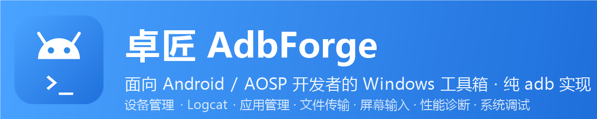
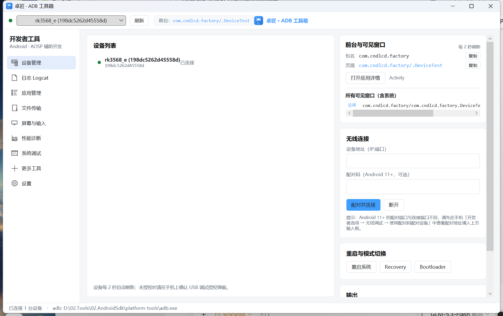
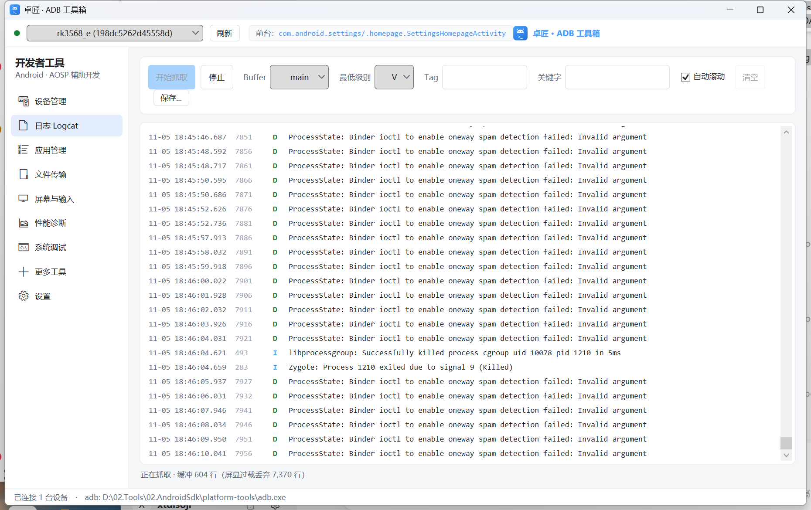
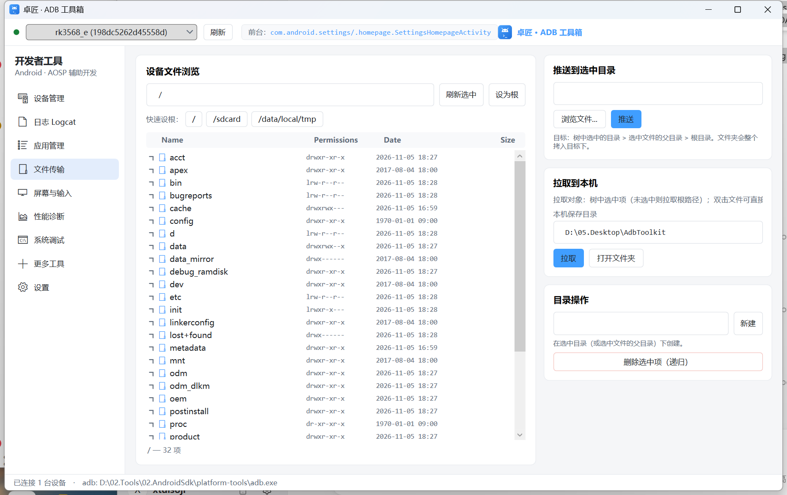
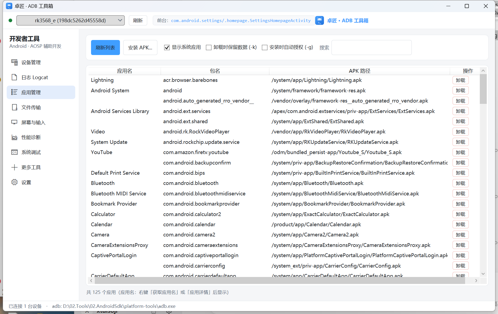
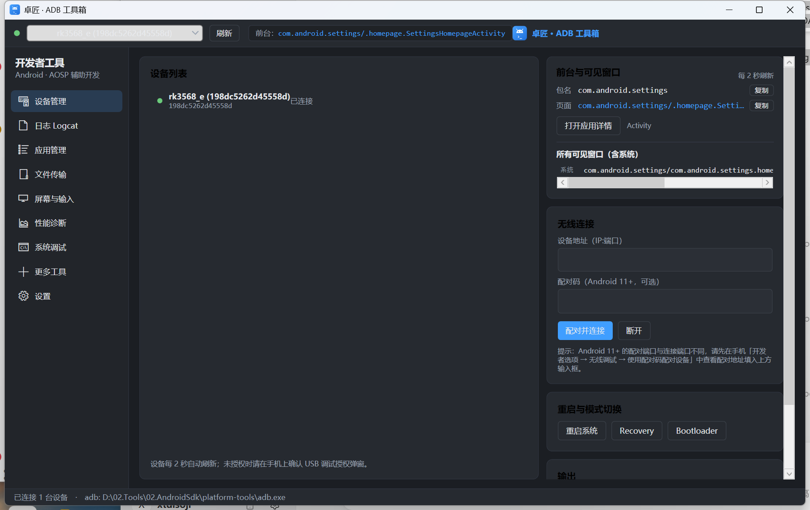

<p align="center">
  
</p>

<div align="center">

# 卓匠 AdbForge

**面向 Android / AOSP 开发者的 Windows 桌面工具箱 —— 所有功能均基于 adb 命令，零外部依赖**

[](../../releases)
[](LICENSE)
[](#-快速开始)
[](#️-从源码构建)

[⬇️ 下载最新版](../../releases/latest) · [🗺️ 功能路线图](docs/ROADMAP.md) · [🐛 问题反馈](../../issues)

</div>

---

## ✨ 为什么选卓匠

- 🔌 **纯 adb 实现** —— 不依赖 scrcpy、aapt 等任何外部工具，解压即用
- 🖥 **九大模块全集成** —— 设备 / 日志 / 应用 / 文件 / 屏幕 / 性能 / 系统调试 / 工具合集
- 🇨🇳 **中文原生界面** —— 为中文开发者设计，浅色 / 深色双主题
- 🖱 **图形化一切** —— 常用 adb 操作全部 GUI 化，右键即用，不用背命令
- 🔒 **本地优先** —— 不收集、不上传任何数据，隐私声明明明白白
- ⚡ **开箱即用** —— 自动探测 adb 路径，首次启动引导三步上手

## 🧩 功能总览

| 模块 | 主要功能 |
|---|---|
| 🖥 **设备管理** | 多设备状态实时监听、无线调试 / 配对（Android 11+）、重启到 Recovery / Bootloader、**前台应用与全部可见窗口实时显示**（含系统应用，[exported] 标记） |
| 📜 **日志 Logcat** | 多 buffer（main/system/crash/kernel/radio…）、级别与 Tag / 关键字过滤、级别着色、限流渲染不卡 UI、一键保存 |
| 📦 **应用管理** | 安装（split APK / -g 授权）/ 卸载 / 错误码中文翻译、**应用名自动解析**、应用详情（版本 / SDK / 权限 / 四大组件 / [exported] 标记）、**提取 APK 到本地**、免 root 停用预装 |
| 📂 **文件传输** | Device Explorer 风格树形浏览（含系统分区）、推送 / 拉取 / 新建 / 删除 / 复制路径，全部右键直达 |
| 📱 **屏幕与输入** | 截图（exec-out 直传）/ 录屏、快捷键面板、**PC 键盘透传**（文本批量 / 系统键 / Ctrl 组合）、UI 层级 dump、Monkey 压测 |
| 📊 **性能诊断** | 设备信息全景、应用详情查询、电量面板 + 虚拟电量、内存 / 启动时间 / 卡顿分析、CPU / GPU 频率与温度、崩溃 / ANR 历史（DropBox） |
| 🔧 **系统调试** | Settings 三表浏览器、getprop 补全提示 + 右键修改、**52 个系统设置页一键直达**、调试预设包（动画归零等）、Intent 构造器、SELinux、build.prop 编辑、终端 |
| 🧰 **更多工具** | 输入法切换、通知测试、全局代理、多用户、权限授予 / 撤销、Bugreport、Sideload 刷 OTA、设备端后台日志（拔线采集） |
| ⚙️ **设置** | adb 路径自动探测、浅色 / 深色主题、更新检查、应用缓存清理 |

## 📸 界面预览

<p align="center">
  
</p>
<p align="center"><em>设备管理页 —— 设备状态 / 前台应用与可见窗口 / 无线调试 / 模式切换</em></p>

<details>
<summary><b>更多界面截图</b>（<code>scripts/capture-ui.ps1</code> 可自动截取，陆续补充）</summary>
<br>

| | |
|---|---|
|  |  |
| *日志 Logcat* | *文件传输* |
|  |  |
| *应用管理* | *深色模式* |

</details>

## 🚀 快速开始

### 环境要求

- Windows 10 / 11（x64）
- adb（Android SDK platform-tools）—— 工具会自动探测；没有 adb 也可在设置页手动指定路径
- 无需安装 .NET（发布版为自包含单文件）

### 下载安装

1. 前往 [Releases](../../releases/latest) 下载 `AdbToolkit-vX.Y.Z-portable.zip`
2. 解压到任意目录，双击 `AdbForge.exe` 运行
3. 首次运行若出现 **SmartScreen** 提示，点击「更多信息 → 仍要运行」（因未做代码签名，属正常现象）

### 从源码运行

```bash
git clone https://github.com/你的用户名/AdbForge.git
cd AdbForge
dotnet run --project src/AdbToolkit
```

> 环境要求：.NET 8 SDK（`winget install Microsoft.DotNet.SDK.8`）

## 📖 使用指南

<details>
<summary><b>🔌 设备连接</b></summary>

- USB 连接：插入设备 → 手机确认 USB 调试授权 → 顶栏自动出现设备
- 无线连接（Android 11+）：手机打开「开发者选项 → 无线调试 → 使用配对码配对设备」→ 在设备管理页填入地址与配对码 → 配对并连接
- 顶栏选中设备后，**所有页面自动跟随**当前设备

</details>

<details>
<summary><b>📜 日志抓取</b></summary>

- 选择 buffer（main / system / crash / kernel / 全部）与最低级别 → 开始抓取
- 支持 Tag 过滤、关键字过滤、自动滚动、保存到本地
- 「更多工具 → 设备端后台日志」可在拔线状态下持续采集（老化测试）

</details>

<details>
<summary><b>📦 应用管理</b></summary>

- 刷新列表 → 搜索应用 → 右键提取 APK / 查看详情（权限、四大组件）
- 「获取应用名」会拉取 APK 并解析 manifest 显示真实应用名（有本地缓存）
- 卸载支持保留数据；预装应用可「显示系统应用」后停用（免 root）

</details>

<details>
<summary><b>📂 文件传输</b></summary>

- 树形浏览整个文件系统（含 /data、/system 等系统分区），展开目录懒加载
- 右键：推送文件 / 文件夹、拉取到本机、新建、删除、复制路径
- 双击文件直接拉取到本机

</details>

<details>
<summary><b>⌨️ 键盘透传</b></summary>

- 「屏幕与输入 → 打开键盘窗口」→ 点击窗口获得焦点 → 直接打字
- 文本走 <code>input text</code> 批量发送；回车 / 方向键等走 <code>keyevent</code>；Ctrl 组合走 <code>keycombination</code>（Android 11+）
- 暂不支持中文（<code>input text</code> 仅 ASCII），中文请用设备端剪贴板粘贴

</details>

## ❓ 常见问题

<details>
<summary><b>运行时出现 SmartScreen 蓝色拦截？</b></summary>
<br>
本工具暂未做代码签名。点击「更多信息 → 仍要运行」即可；介意的话可以自行从源码构建。
</details>

<details>
<summary><b>设备一直显示 offline / unauthorized？</b></summary>
<br>
unauthorized：在手机上确认 USB 调试授权弹窗。<br>
offline：多为多个工具争用 adb server（端口 5037 冲突），在「更多工具 → ADB Server 管理」重启 server 即可。
</details>

<details>
<summary><b>哪些功能需要 root？</b></summary>
<br>
build.prop 编辑、setenforce、/data 分区深层目录、部分属性修改需要 root 或 userdebug 固件；界面中均已标注，无 root 时会给出友好提示而不是报错。
</details>

<details>
<summary><b>键盘透传打不了中文？</b></summary>
<br>
<code>input text</code> 仅支持 ASCII，这是 adb 的限制。中文请先在 PC 复制 → 设备端粘贴；后续版本计划内置 ADB IME 输入法彻底解决。
</details>

## 🛠️ 从源码构建

```bash
# 构建
dotnet build AdbToolkit.sln

# 运行
dotnet run --project src/AdbToolkit

# 发布自包含单文件 + 便携 zip
powershell -ExecutionPolicy Bypass -File scripts/publish.ps1 -Version 0.2.0
```

辅助脚本：

| 脚本 | 用途 |
|---|---|
| `scripts/publish.ps1` | 发布单文件 exe + 打包便携 zip |
| `scripts/make-icon.ps1` | 重新生成应用图标（ICO / PNG） |
| `scripts/make-banner.ps1` | 重新生成 README 顶部 Banner |
| `scripts/capture-ui.ps1` | 截取运行中的应用窗口到 `docs/images/` |

## 🗺️ 路线图

详见 [docs/ROADMAP.md](docs/ROADMAP.md)。近期计划：

- [ ] 包名 → PID 无感过滤 Logcat
- [ ] 内置 ADB IME（键盘透传支持中文）
- [ ] 文件树拖拽推送
- [ ] 崩溃 / ANR 后台监听提醒
- [ ] 独立 adb server 端口（解决 5037 冲突）

## 🤝 贡献

Issue 与 PR 都欢迎！提交 PR 前请确保 `dotnet build` 零警告零错误。

## 📄 许可证

[MIT](LICENSE) © 2026 AdbForge Contributors

## 🙏 致谢

- [Android Debug Bridge](https://developer.android.com/tools/adb) —— 一切能力的基石
- [scrcpy](https://github.com/Genymobile/scrcpy) —— 屏幕镜像与 adb 深度用法的灵感来源
- 所有试用与反馈的开发者们 ❤️
