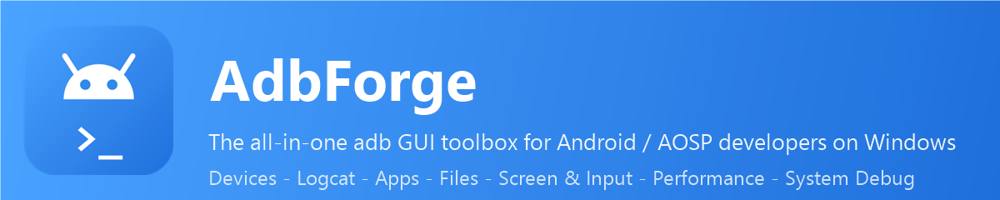
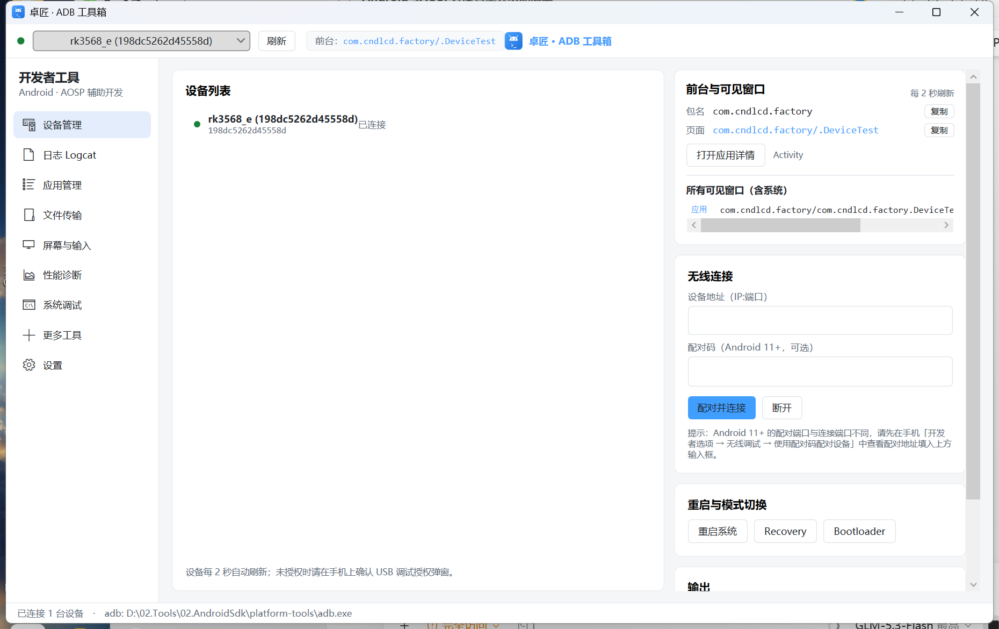
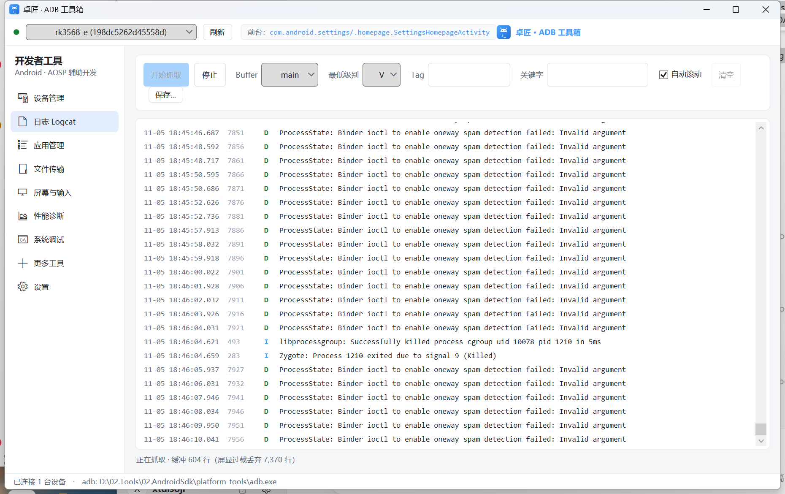
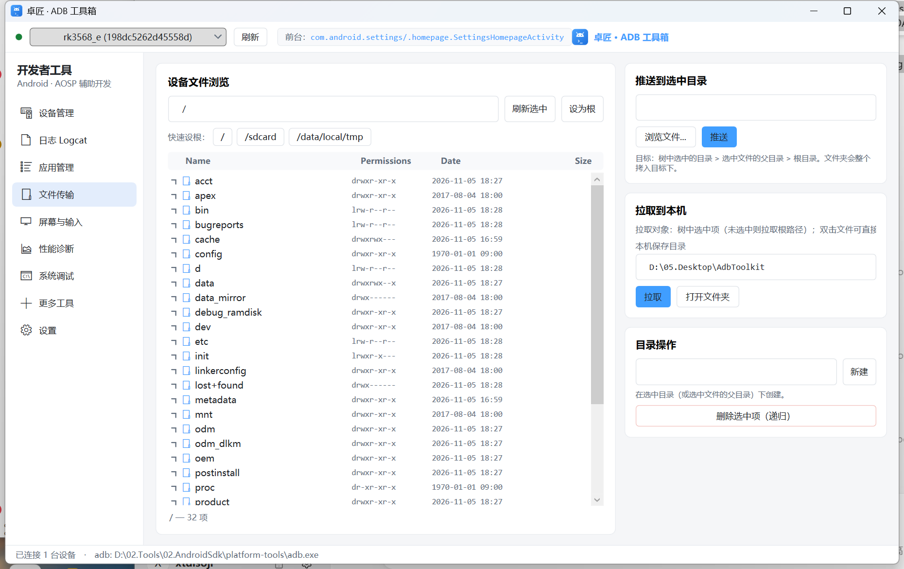
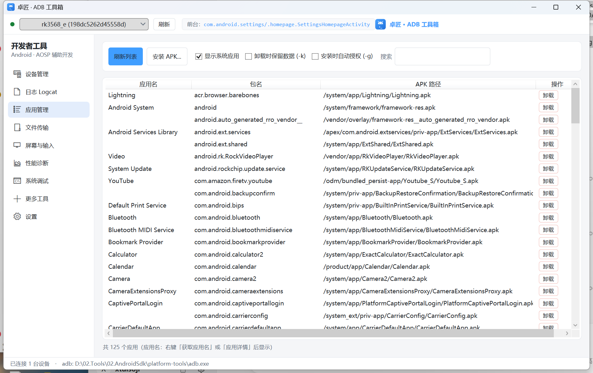
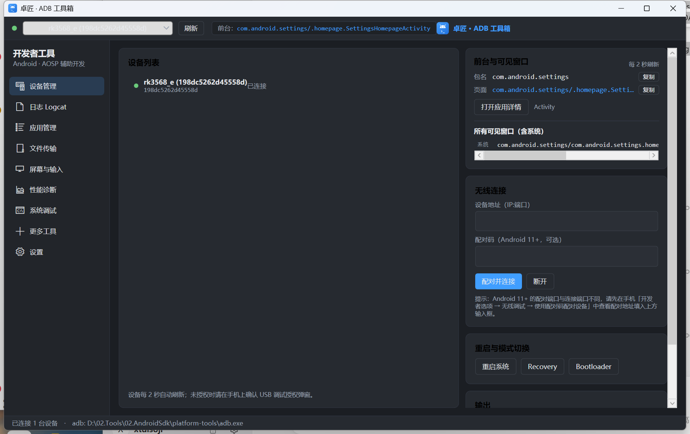

<p align="center">
  
</p>

<div align="center">

# AdbForge

**The all-in-one Windows desktop toolbox for Android / AOSP developers — everything built on pure adb commands, zero external dependencies**

English | [简体中文](README.md)

[](../../releases)
[](LICENSE)
[](#-getting-started)
[](#%EF%B8%8F-build-from-source)

[⬇️ Latest Release](../../releases/latest) · [🗺️ Roadmap](docs/ROADMAP.md) · [🐛 Issues](../../issues)

</div>

---

## ✨ Why AdbForge

- 🔌 **Pure adb** — no scrcpy, no aapt, no bundled drivers needed. Unzip and it just works
- 🖥 **Nine modules, one app** — devices / logs / apps / files / screen / performance / system debug / toolkit
- 🖱 **Everything GUI** — common adb workflows right at your fingertips, right-click everywhere
- 🔒 **Local-first** — no data collection, no uploads, transparent privacy statement
- ⚡ **Zero setup** — auto-detects adb (one is even bundled with releases), first-run guide included
- 🌗 **Light & dark themes**

## 🧩 Feature Overview

| Module | Highlights |
|---|---|
| 🖥 **Devices** | Live multi-device status, wireless debugging / pairing (Android 11+), reboot to Recovery / Bootloader, **live foreground app & all visible windows** (incl. system apps, `[exported]` flags) |
| 📜 **Logcat** | Multiple buffers (main/system/crash/kernel/radio…), level & tag / keyword filters, colored levels, throttled rendering, save to file |
| 📦 **Apps** | Install (split APK / auto-grant) / uninstall / translated error codes, **automatic app-name resolution**, app details (version / SDK / permissions / all four component types / `[exported]`), **extract APK to PC**, disable pre-installed apps without root |
| 📂 **Files** | Device Explorer-style tree browser (incl. system partitions), push / pull / mkdir / delete / copy path — all in the context menu |
| 📱 **Screen & Input** | Screenshot (binary-safe exec-out) / screen record, hotkey panel, **PC keyboard forwarding** (batched text / system keys / Ctrl combos), UI hierarchy dump, Monkey stress testing |
| 📊 **Performance** | Full device info card, per-app details, battery panel + simulated battery, memory / startup / jank analysis, CPU / GPU clocks & thermal zones, crash / ANR history (DropBox) |
| 🔧 **System Debug** | Settings browser (system/secure/global), getprop with autocomplete + right-click edit, **52 one-click system settings pages**, debug presets, Intent builder, SELinux toggle, build.prop editor, terminal |
| 🧰 **Toolkit** | IME switching, notification testing, global proxy, multi-user, permission grant / revoke, Bugreport, Sideload OTA, on-device background logging |
| ⚙️ **Settings** | adb path auto-detection, light / dark theme, update check, cache cleanup |

## 📸 Screenshots

<p align="center">
  
</p>
<p align="center"><em>Devices page — device status / live foreground app / wireless debugging / reboot modes</em></p>

<details>
<summary><b>More screenshots</b> (auto-captured via <code>scripts/capture-ui.ps1</code>)</summary>
<br>

| | |
|---|---|
|  |  |
| *Logcat* | *File transfer* |
|  |  |
| *App management* | *Dark mode* |

</details>

## 🚀 Getting Started

### Requirements

- Windows 10 / 11 (x64)
- adb (Android SDK platform-tools) — **bundled with releases**, or auto-detected from your existing installation
- No .NET installation needed (self-contained single file)

### Install

1. Grab `AdbForge-X.Y.Z-portable.zip` from the [latest release](../../releases/latest)
2. Unzip anywhere, run `AdbForge.exe`
3. If **SmartScreen** shows a warning on first run, click "More info → Run anyway" (the binaries are not code-signed yet)

### Run from source

```bash
git clone https://github.com/ideastudios/AdbForge.git
cd AdbForge
dotnet run --project src/AdbToolkit
```

> Requires the .NET 8 SDK (`winget install Microsoft.DotNet.SDK.8`)

## 📖 Usage Guide

<details>
<summary><b>🔌 Connecting devices</b></summary>

- USB: plug in → accept the debugging prompt on the device → it appears in the top bar automatically
- Wireless (Android 11+): enable "Wireless debugging → Pair device with pairing code" on the device → enter address + code on the Devices page → Pair & connect
- The device selected in the top bar is shared across **all pages**

</details>

<details>
<summary><b>📜 Capturing logs</b></summary>

- Pick a buffer (main / system / crash / kernel / all) and minimum level → Start
- Filter by tag / keyword, autoscroll, save to file
- "Toolkit → On-device background logging" keeps capturing with the cable unplugged ( endurance tests)

</details>

<details>
<summary><b>📦 Managing apps</b></summary>

- Refresh → search → right-click to extract the APK / open app details (permissions, all activities)
- "Fetch app name" pulls the APK and parses the manifest for the real display name (cached locally)
- Uninstall keeps data optionally; pre-installed apps can be disabled without root ("Show system apps")

</details>

<details>
<summary><b>📂 File transfer</b></summary>

- Tree browser for the whole filesystem (incl. /data, /system), lazy-loaded per directory
- Right-click: push file / folder, pull to PC, mkdir, delete, copy path
- Double-click a file to pull it to your PC

</details>

<details>
<summary><b>⌨️ Keyboard forwarding</b></summary>

- "Screen & Input → Open keyboard window" → click it to focus → type
- Text goes through <code>input text</code> in batches; Enter / arrows etc. via <code>keyevent</code>; Ctrl combos via <code>keycombination</code> (Android 11+)
- Non-ASCII (e.g. Chinese) is not supported by <code>input text</code> — use the device-side clipboard

</details>

## ❓ FAQ

<details>
<summary><b>SmartScreen shows a blue warning on first run?</b></summary>
<br>
The binaries are not code-signed yet. Click "More info → Run anyway", or build from source yourself.
</details>

<details>
<summary><b>Device shows offline / unauthorized?</b></summary>
<br>
unauthorized: accept the USB debugging prompt on the device.<br>
offline: usually another tool is fighting over the adb server (port 5037) — restart the server from "Toolkit → ADB Server".
</details>

<details>
<summary><b>Which features need root?</b></summary>
<br>
build.prop editing, setenforce, deep /data directories and some property writes need root or a userdebug build. Everything root-related is labeled in the UI and fails with a friendly message instead of a stack trace.
</details>

<details>
<summary><b>Keyboard forwarding can't type Chinese?</b></summary>
<br>
<code>input text</code> only supports ASCII — an adb limitation. Copy on PC → paste on device for now; a built-in ADB IME is planned to solve this properly.
</details>

## 🛠️ Build from Source

```bash
# Build
dotnet build AdbToolkit.sln

# Run
dotnet run --project src/AdbToolkit

# Self-contained single file + portable zip
powershell -ExecutionPolicy Bypass -File scripts/publish.ps1 -Version 0.2.1
```

Helper scripts:

| Script | Purpose |
|---|---|
| `scripts/publish.ps1` | Publish single-file exe + portable zip |
| `scripts/make-icon.ps1` | Regenerate the app icon (ICO / PNG) |
| `scripts/make-banner.ps1` / `make-banner-en.ps1` | Regenerate README banners |
| `scripts/capture-ui.ps1` | Capture the running app window to `docs/images/` |
| `scripts/take-screenshots.ps1` | Full screenshot pipeline (auto page navigation) |

## 🗺️ Roadmap

See [docs/ROADMAP.md](docs/ROADMAP.md).

## 🤝 Contributing

Issues and PRs are welcome! Please make sure `dotnet build` passes with zero warnings before submitting.

## 📄 License

[MIT](LICENSE) © 2026 AdbForge Contributors

## 🙏 Acknowledgments

- [Android Debug Bridge](https://developer.android.com/tools/adb) — the foundation of everything
- [scrcpy](https://github.com/Genymobile/scrcpy) — inspiration for deep adb usage and screen mirroring
- Every developer who tried the tool and gave feedback ❤️
